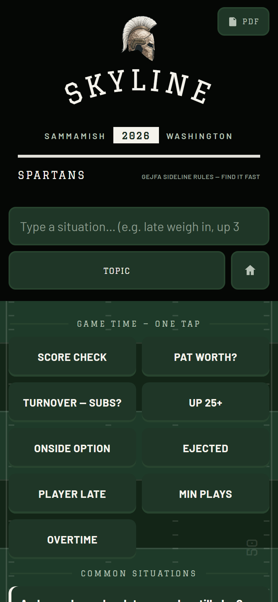
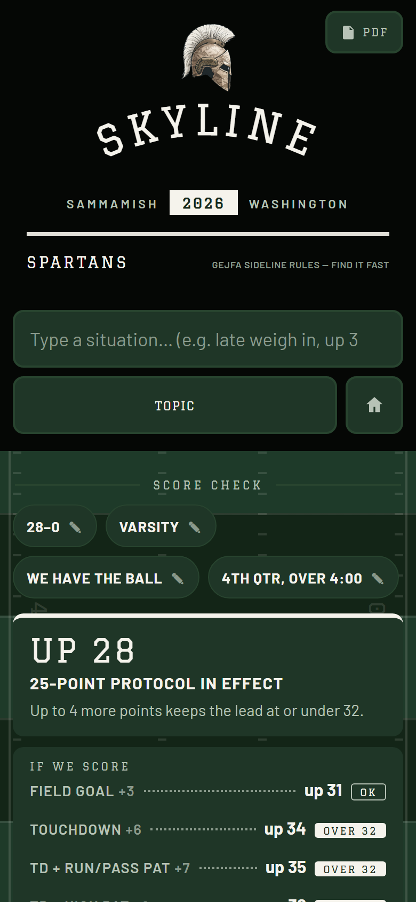
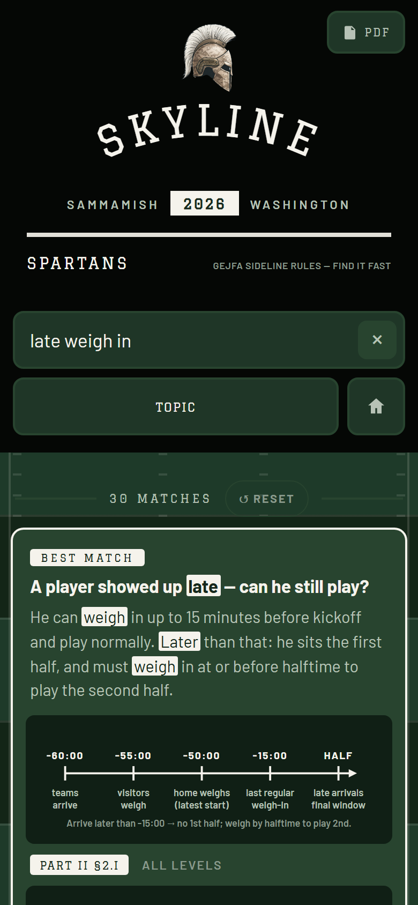
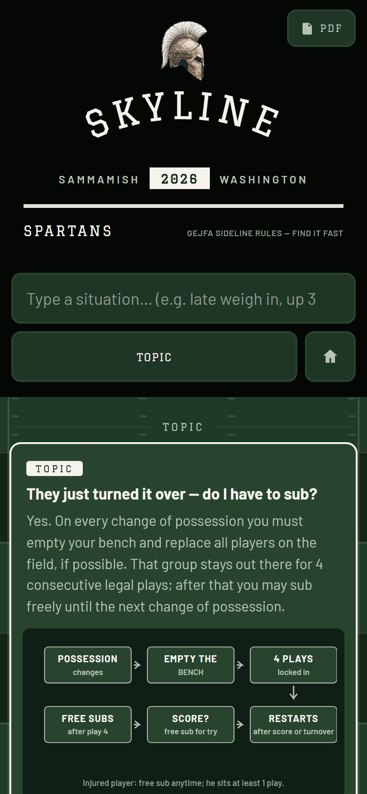

# GEJFA Rules — Sideline Lookup

Instant lookup for the **2026 GEJFA rulebook** (Greater Eastside Junior Football Association). Built for coaches on the sideline: type a situation, get the ruling in seconds — with the exact citation and official rule text one tap away.

**Score check:** up 28-0 and not sure what's still legal? Tap **Score check**, enter the score, answer three taps (level — Cubs are 8- or 11-player depending on the Council vote — what's happening, quarter), and get the call: which scores stay at or under the 32-point cap, the possession and clock rules in effect right now, and the consequences — every line cited to the rule. No AI; works offline.

**Live app:** https://alienfacepalm.github.io/gejfa-rules/

## Screenshots

| Home: Game Time tiles | Score check: the call for 28-0 | Search: type a situation | Topic: ruling + official text |
|---|---|---|---|
|  |  |  |  |

These are generated, not hand-made: `pnpm screenshots` serves `docs/`, drives headless Chrome at phone width, and rewrites `screenshots/*.png`. **Whenever a widget is added or changed, add or update its entry in `scripts/readme-screenshots.mjs`, run `pnpm screenshots`, and commit the PNGs with the change** so this section never drifts from the app (see SPEC.md §9).

## Use it on your phone

Open the link above, then:
- **Android (Chrome/Edge):** menu → **Install app** (or "Add to Home screen")
- **iPhone (Safari):** Share → **Add to Home Screen**

After the first load it works fully **offline** — no signal needed at the field.

## What's inside

- `docs/` — the app (static PWA, no build step, no backend)
  - `data/rules.js` — the 2026 rulebook structured into 90 entries (plain-English answer + citation + verbatim rule text), including an **Rule Contradictions** category: the places where the 2026 book contradicts itself, each with the conflicting quotes, what the app assumes, and the question to put to the league
  - `data/situations.js` — 48 common sideline scenarios
  - `data/synonyms.js` — coach-speak → rulebook-term search expansion
  - `data/diagrams.js` — chalk-style SVG diagrams (possession spots, 8-player formation, OT formats, brackets…)
  - `data/flows.js` + `flows.js` — the Score check guided flow: question steps, rule-cited callouts, and the pure resolver
  - `search.js` — pure search/ranking logic (portable to a native port)
- `2026 GEJFA Rules.pdf` — the source rulebook (also served as `docs/2026-gejfa-rules.pdf`)
- `DESIGN.md` — art direction source of truth (collegiate athletic apparel spec)
- `SPEC.md` — the project's source of truth (accuracy mandate, architecture, verification gate)
- `tests/verify-rules.cjs` — pre-deploy gate (`pnpm test`): structure, source fidelity, anchor facts, search, Score check scenarios
- `scripts/readme-screenshots.mjs` — regenerates the screenshots above (`pnpm screenshots`)

## Developing

```
pnpm install       # Node 22+ (the screenshot script uses Node's built-in WebSocket)
pnpm test          # must pass before any push
pnpm typecheck     # when src/ changed
pnpm css           # when Tailwind classes in docs/index.html or app.js changed (compiles src/tailwind.css -> docs/tailwind.css)
pnpm screenshots   # when a widget changed
pnpm build         # css + typecheck + test + screenshots — the full pre-deploy gate
```

There is no bundling step: `docs/` is deployed exactly as committed. "Build" here means "prove it is safe to push".

## Updating for a new season

1. Re-curate `docs/data/rules.js` / `situations.js` from the new rulebook (full procedure: SPEC.md §10)
2. Bump `GEJFA_VERSION` in `docs/version.js` (the footer shows it; the service worker cache is named from it)
3. `pnpm test`, then push — installed apps pick up the new rules on next launch with connectivity

Quick-reference only — the official GEJFA rulebook and NFHS rules govern.
